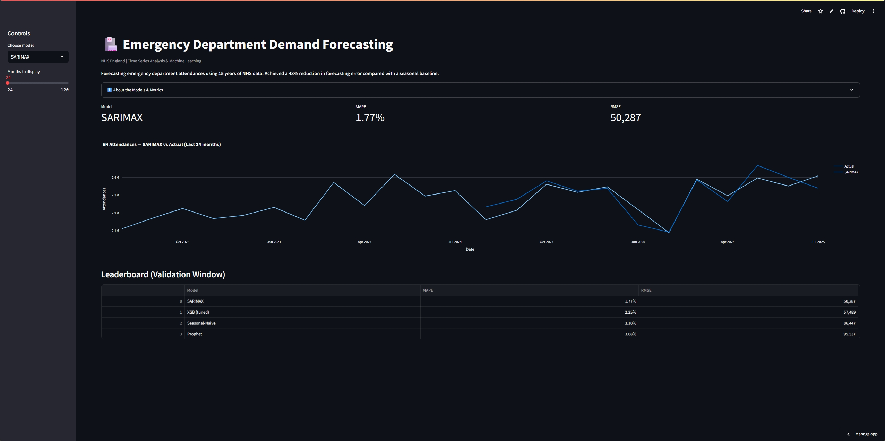
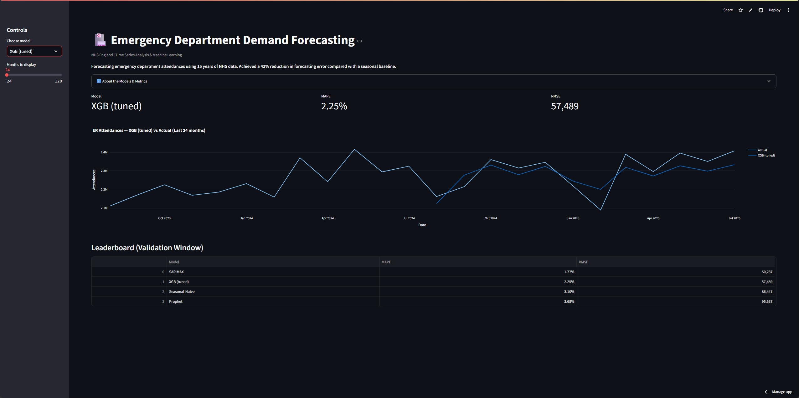

# 🏥 Emergency Department Demand Forecasting

### NHS England | Time Series Analysis & Machine Learning

An end-to-end forecasting project using **15 years of NHS England A&E attendance data** to predict emergency department demand. Compared SARIMAX, Prophet, and XGBoost against a seasonal-naïve baseline, achieving a **43% reduction in forecasting error (MAPE: 3.10% → 1.77%)**.

### 🚀 [View Live Streamlit Dashboard](https://er-admissions-forecast-vbdttw7nayjqnqxjdjfbxu.streamlit.app/)

## 📌 Project Overview

Emergency departments face fluctuating patient demand, creating challenges for staffing and resource allocation. This project analyzes historical attendance patterns and evaluates forecasting models to demonstrate how predictive analytics could support healthcare capacity planning.

### 🎯 Objectives
- Analyze trends and seasonal patterns in monthly A&E attendances.
- Compare statistical and machine learning forecasting models.
- Evaluate accuracy against a seasonal-naïve baseline using MAPE and RMSE.
- Build an interactive dashboard to visualize predictions and model performance.

## 🛠️ Methodology

**1. Data Preparation**
- Cleaned and standardized monthly NHS England attendance data.
- Identified historical trends, seasonal patterns, and anomalies.

**2. Feature Engineering**
- Lag features: 1, 2, 3, and 12 months.
- Rolling averages: 3, 6, and 12 months.
- Seasonal indicators and UK public holiday features.

**3. Forecasting Models**
- **Seasonal-Naïve:** Uses attendance from the same month of the previous year.
- **SARIMAX:** Statistical model capturing seasonal and autoregressive patterns.
- **Prophet:** Trend and seasonality forecasting with holiday effects.
- **XGBoost:** Gradient boosting using engineered historical features.

**4. Model Evaluation**
- Evaluated models using a 12-month holdout and rolling backtesting.
- Compared accuracy using MAPE and RMSE.

## 📊 Model Performance

| Model | MAPE | RMSE |
|---|---:|---:|
| Seasonal-Naïve | 3.10% | 86,447 |
| **SARIMAX** | **1.77%** | **50,287** |
| Prophet | 3.68% | 95,537 |
| XGBoost (Tuned) | 2.25% | 57,489 |

**🏆 Key Result:** SARIMAX achieved the strongest performance, reducing MAPE by approximately **43%** compared with the seasonal-naïve baseline.

These results highlight how statistical forecasting can outperform more complex machine learning approaches when strong seasonal patterns exist.

## 📈 Interactive Dashboard

Built with **Streamlit and Plotly** to make forecasting results accessible and interactive.

Features include:
- Actual vs. predicted attendance visualizations.
- Model selection across four forecasting approaches.
- Interactive MAPE and RMSE performance metrics.
- Adjustable historical time windows and model leaderboard.

**[🚀 Launch Dashboard](https://er-admissions-forecast-vbdttw7nayjqnqxjdjfbxu.streamlit.app/)**

## 📸 Dashboard Preview

### SARIMAX Forecasting Performance


### XGBoost Model Comparison


## 💻 Technologies

**Python, Pandas, NumPy, SARIMAX, Prophet, XGBoost, Scikit-learn, Statsmodels, Plotly, Streamlit, Jupyter Notebook, Git**

## ⚙️ Run Locally

Python 3.12 recommended.

```bash
git clone https://github.com/Collinmartin04/ER-Admissions-Forecast.git
cd ER-Admissions-Forecast/er-forecast
python -m pip install -r requirements.txt
python -m streamlit run app.py
```

Open `http://localhost:8501` to access the dashboard.

## 💡 Key Takeaways

- **SARIMAX outperformed Prophet and XGBoost**, demonstrating the importance of matching models to the structure of the data.
- **Baseline comparisons and rolling backtesting** helped evaluate forecasting performance.
- **Interactive visualization** made model results easier to interpret and communicate.
- More accurate demand forecasting could support healthcare staffing and capacity planning decisions.

---

**[GitHub Repository](https://github.com/Collinmartin04/ER-Admissions-Forecast)** | **[Live Dashboard](https://er-admissions-forecast-vbdttw7nayjqnqxjdjfbxu.streamlit.app/)**